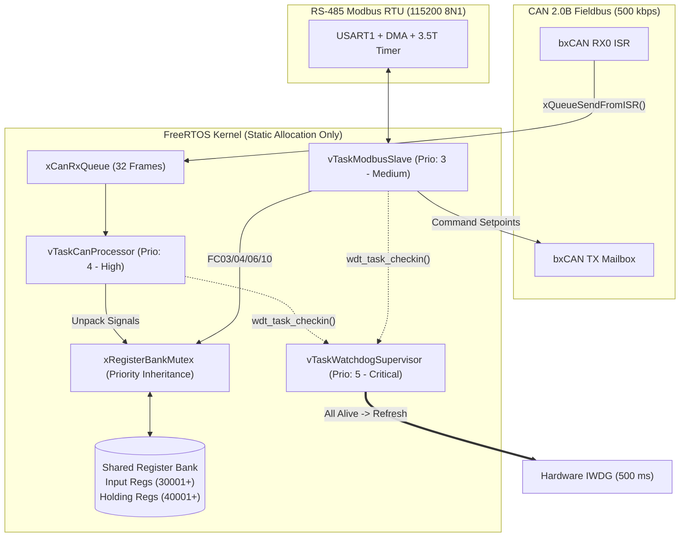

# FreeRTOS CAN 2.0B to Modbus RTU Industrial Protocol Gateway (`freertos-canbus-modbus-gateway`)

[](https://github.com/Yigitcakirdogan/freertos-canbus-modbus-gateway/actions/workflows/ci.yml)


A deterministic **FreeRTOS-based industrial communication gateway** that bridges **CAN 2.0B (ISO 11898)** fieldbus nodes (traction inverters, BMS packs, industrial actuators) with a supervisory **Modbus RTU (RS-485)** SCADA/PLC master.

Designed with **zero dynamic memory allocation (`xTaskCreateStatic`)**, **table-driven CRC-16/MODBUS**, **thread-safe register bank synchronization**, and a **multi-task Deadman Watchdog Supervisor (`IWDG`)**.

---

## System Architecture & Task Topology



---

## Rate Monotonic Task Partitioning

| Task Name | Priority | Period / Trigger | Stack Size (Words) | Responsibility |
| :--- | :---: | :---: | :---: | :--- |
| `vTaskWatchdogSupervisor` | `5` (Highest) | `100 ms` Periodic | `128` | Verifies bitmask check-ins from all worker tasks before kicking `IWDG`. |
| `vTaskCanProcessor` | `4` | Event (`xCanRxQueue`) + `20 ms` Timeout | `256` | Decodes CAN 2.0B telemetry frames, monitors node heartbeats, updates Input Registers. |
| `vTaskModbusSlave` | `3` | Event (`3.5T` Frame Silence) | `256` | Validates Modbus RTU CRC-16, executes `FC03`/`FC04`/`FC06`/`FC10`, queues CAN setpoint frames. |
| `vTaskDiagnostics` | `1` (Lowest) | `1000 ms` Periodic | `192` | Tracks bus error counters, CRC failures, and stack high-watermarks. |

---

## CAN 2.0B to Modbus Register Mapping

| CAN ID | Frame Name | Signal | Scaling & Offset | Modbus Register | Type |
| :---: | :--- | :--- | :--- | :---: | :---: |
| `0x180` | `INV_STATUS_1` | Motor Speed (RPM) | `1 rpm/bit`, Unsigned | `Input Reg 0x0000` | Read-Only (`FC04`) |
| `0x180` | `INV_STATUS_1` | Inverter Temp (°C) | `0.1 °C/bit`, Offset `-40°C` | `Input Reg 0x0001` | Read-Only (`FC04`) |
| `0x180` | `INV_STATUS_1` | DC Bus Voltage (dV) | `0.1 V/bit`, Unsigned | `Input Reg 0x0002` | Read-Only (`FC04`) |
| `0x280` | `BMS_PACK_STAT` | Pack Current (dA) | `0.1 A/bit`, Signed | `Input Reg 0x0003` | Read-Only (`FC04`) |
| `0x280` | `BMS_PACK_STAT` | State of Charge (%) | `0.5 %/bit`, Unsigned | `Input Reg 0x0004` | Read-Only (`FC04`) |
| `0x200` | `INV_CMD_SET` | Target Torque (`Nm*10`) | `0.1 Nm/bit` | `Holding Reg 0x0000` | Read/Write (`FC03/06/10`) |
| `0x200` | `INV_CMD_SET` | Max Speed Limit (RPM) | `1 rpm/bit` | `Holding Reg 0x0001` | Read/Write (`FC03/06/10`) |
| `0x200` | `INV_CMD_SET` | Enable / Fault Reset | Bitmask (`Bit 0: EN, Bit 1: RST`) | `Holding Reg 0x0002` | Read/Write (`FC03/06/10`) |

---

## Build & Run Unit Tests

```bash
cmake -B build -DCMAKE_BUILD_TYPE=Release
cmake --build build
ctest --test-dir build --output-on-failure
```

---

## License

Released under the [MIT License](LICENSE).
